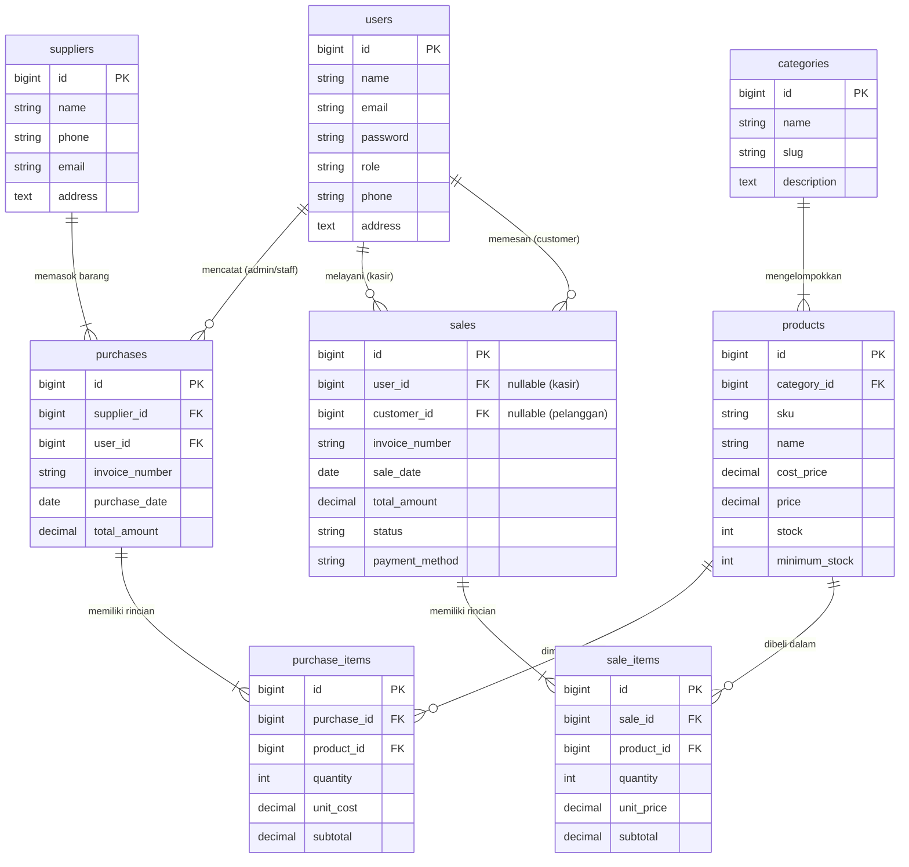

# Dezzana Hijab - Inventory & Sales Management System

Sistem manajemen inventaris butik hijab dan point of sales (POS) terintegrasi berbasis **Laravel 12**, dilengkapi dengan otentikasi multi-peran (*Multi-Role RBAC*), *pessimistic locking* untuk pencegahan *overselling*, isolasi data transaksi via *Policy*, serta katalog belanja *self-checkout* untuk pelanggan.

---

## 1. Arsitektur & Fitur Utama

Aplikasi dirancang mengikuti standar rekayasa perangkat lunak modern dan pola arsitektur **MVC (Model-View-Controller)**:

1. **Multi-Role Access Control (3 Peran Pengguna):**
   - **Admin / Owner:** Kontrol penuh atas Master Data (Kategori, Produk, Pemasok), Riwayat Pengadaan Stok (*Purchases*), Seluruh Riwayat Penjualan (*Sales*), dan Ringkasan Omzet Dashboard.
   - **Staff / Kasir:** Input transaksi penjualan kasir langsung (POS), pencatatan barang masuk dari pemasok (*Stock-in*), pemantauan stok produk di katalog. Dibatasi dari modul manajemen data master sensitif dan dashboard finansial owner.
   - **Customer / Pelanggan:** Registrasi mandiri publik (*Self-Registration*), eksplorasi katalog produk dengan filter kategori & pencarian kata kunci, pemesanan produk mandiri (*Self-Checkout*), serta riwayat pesanan pribadi yang **terisolasi ketat** via *Policy*.

2. **Konsistensi Data & Keamanan Transaksi (ACID):**
   - **Atomisitas Transaksi (`DB::transaction`):** Seluruh pencatatan header penjualan/pembelian dan mutasi stok item dijalankan dalam satu blok transaksi database. Jika terjadi kegagalan atau stok kurang, seluruh proses di-*rollback* otomatis.
   - **Pessimistic Locking (`lockForUpdate`):** Pencegahan *race condition* dan *overselling* saat beberapa pelanggan atau kasir memesan produk yang sama secara simultan:
     ```php
     $product = Product::where('id', $prodId)->lockForUpdate()->findOrFail();
     ```
   - **Integritas Harga (*Server-Side Calculation*):** Harga satuan dan subtotal dihitung murni dari kolom `price` pada database server. Nilai harga dari HTTP request client diabaikan untuk mencegah manipulasi via Inspect Element / API tools.
   - **Isolasi Data Pesanan (`SalePolicy`):** Pelanggan hanya dapat melihat nota transaksinya sendiri:
     ```php
     $this->authorize('view', $sale); // Mengembalikan HTTP 403 Forbidden jika bukan pemilik
     ```

3. **Optimasi Query & UI:**
   - **Eager Loading:** Pencegahan masalah query *N+1* menggunakan klausa `with(['user', 'customer', 'items.product'])`.
   - **Search & Filter:** Pencarian teks dan filter tanggal/status pada seluruh modul arsip.
   - **Desain Bersih & Responsif:** Antarmuka modern dengan Tailwind CSS (Baby Blue & Navy Slate palette) bebas dari generic AI slop.

---

## 2. Kredensial Akun Pengujian (*Demo Accounts*)

Semua akun menggunakan kata sandi bawaan: `password`

| Role | Nama Pengguna | Alamat Email | Password | Hak Akses Utama |
| :--- | :--- | :--- | :--- | :--- |
| **Admin** | Owner Admin Hijab | `admin@dezzanahijab.com` | `password` | Akses penuh CRUD, Eksekutif Dashboard, Stok Rendah |
| **Staff** | Kasir / Staff Toko | `staff@dezzanahijab.com` | `password` | POS Kasir, Restock Pemasok, Pemantauan Stok |
| **Customer** | Siti Aisyah | `pelanggan@dezzanahijab.com` | `password` | Self-Checkout Katalog, Riwayat Pesanan Pribadi |

*Catatan: Pengunjung umum dapat mendaftar akun baru melalui tombol **"Daftar Akun Pelanggan"** pada halaman login.*

---

## 3. Panduan Instalasi & Menjalankan Proyek (*Reproducible Setup*)

Pastikan komputer Anda telah terpasang:
- **PHP >= 8.2**
- **Composer**
- **MySQL / MariaDB** (melalui XAMPP / Laragon / Docker)

### Langkah-langkah:

1. **Clone repositori dan masuk ke direktori proyek:**
   ```bash
   git clone <URL_REPOSITORY_ANDA>
   cd hijab-inventory-system
   ```

2. **Pasang dependensi PHP:**
   ```bash
   composer install
   ```

3. **Salin konfigurasi lingkungan (.env):**
   ```bash
   cp .env.example .env
   ```

4. **Konfigurasi Database di file `.env`:**
   ```ini
   DB_CONNECTION=mysql
   DB_HOST=127.0.0.1
   DB_PORT=3306
   DB_DATABASE=db_toko_kerudung
   DB_USERNAME=root
   DB_PASSWORD=
   ```
   *Pastikan database `db_toko_kerudung` sudah dibuat di MySQL Anda.*

5. **Generate Application Key:**
   ```bash
   php artisan key:generate
   ```

6. **Jalankan Migrasi Database beserta Data Awal (Seeders):**
   ```bash
   php artisan migrate:fresh --seed
   ```

7. **Jalankan Development Server:**
   ```bash
   php artisan serve
   ```
   Akses aplikasi pada peramban Anda melalui: **`http://localhost:8000`**

---

## 4. Matriks Pengujian Skenario & Keamanan

| Skenario Uji | Tindakan / Endpoint | Ekspektasi Sistem | Status Hasil |
| :--- | :--- | :--- | :---: |
| **Registrasi Publik** | Mendaftar via `/register` dengan data lengkap. | Akun dibuat otomatis dengan `role = 'customer'`, login langsung. | **PASS** |
| **Proteksi Dashboard Admin** | Customer mengakses URL `/admin/dashboard`. | Dicegah oleh `RoleMiddleware`, mengembalikan status 403 atau dialihkan ke dashboard pelanggan. | **PASS** |
| **Isolasi Pesanan Pelanggan** | Customer A membuka URL nota transaksi milik Customer B (`/sales/{id_lain}`). | Sistem mengeksekusi `SalePolicy@view` dan memblokir dengan response **403 Forbidden**. | **PASS** |
| **Pencegahan Overselling** | Customer / Kasir membeli produk dengan jumlah melebihi stok yang ada di database. | Transaksi ditolak di dalam `DB::transaction()`, muncul pesan peringatan, stok tidak berkurang. | **PASS** |
| **Integritas Harga Server** | Client memodifikasi field harga sebelum POST ke `/customer/checkout`. | Sistem mengabaikan input harga client dan menghitung ulang subtotal murni dari database. | **PASS** |
| **Otomatisasi Stok Restock** | Staff mencatat barang masuk di `/purchases/create`. | Kuantitas stok produk di tabel `products` bertambah secara otomatis sesuai item masuk. | **PASS** |

---

## 5. ERD (Entity Relationship Diagram) & Basis Data Relasional

GitHub merender diagram basis data berikut secara otomatis:



### Rincian Relasi Eloquent:
- **`Category hasMany Products` / `Product belongsTo Category`** (1 : N): Pengelompokan jenis hijab.
- **`Supplier hasMany Purchases` / `Purchase belongsTo Supplier`** (1 : N): Riwayat pengadaan dari konveksi/pabrik tekstil.
- **`Purchase hasMany PurchaseItems` / `PurchaseItem belongsTo Product`** (1 : N): Rincian restock barang masuk (stok bertambah).
- **`Sale hasMany SaleItems` / `SaleItem belongsTo Product`** (1 : N): Rincian produk terjual pada nota kasir/self-checkout (stok berkurang).
- **`User hasMany Sales` & `User hasMany Purchases`** (1 : N): Audit trail pencatatan kasir dan staf logistik.

---

&copy; {{ date('Y') }} **Dezzana Hijab** &bull; Integrated Laravel Project (Web Programming 2).
